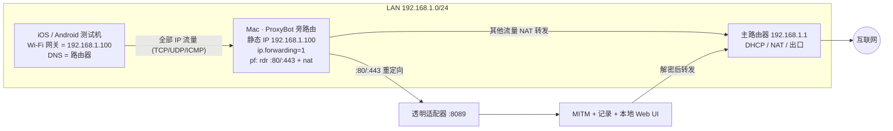
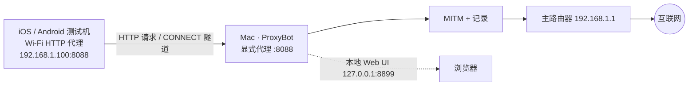

# 原始产品形态 Review 与最小化重写架构提案

- 日期：2026-10-23
- 状态：Proposal（待产品 owner 决策；不是已接受的 ADR）
- 目的：抛开现有技术架构与设计，回到项目最初要解决的问题，给出一个成本最低、实现最小的全新架构。

---

## 0. 结论先行

**原始产品一句话**：让同一 Wi-Fi 下的手机把网关/DNS 指向 Mac，自动捕获并解密 App 的 HTTPS/WSS 流量，按 App（微信/抖音/支付宝）和域名归类，开发者能直接看、筛、导出。

**原始形态的真正价值**（值得保留）：

1. **近零配置采集**：手机不用为每个 App 配代理，改一次网关/DNS 即可；
2. **App 归因**：看到的不是一堆 host，而是"这是微信在请求"；
3. **请求检查闭环**：列表 → 详情 → 过滤 → 导出，四步完成一次调试。

**当前项目的失败模式**：把"抓包工具"扩成了"AI 流量平台"（NetMind Agent 路线）——AI 推断、OpenAPI 生成、mock、部署、Graph/Topology、MCP、dashboard、插件、workspace…… 最终 **123 个命令、16 条前端路由、40.8k 行 Rust + 14k 行 TS、672 个 Cargo 包**。真正的最小可用路径被淹没，发布、签名、真机验证反而长期没有闭环。

**建议的新架构**：**单二进制 Rust（MITM + 本地 Web UI + SQLite），无 Tauri、无 Node/React 构建链**。

- 核心 MVP：显式代理模式；约 **3–4k 行 Rust + ~600 行 HTML/JS**；**10–15 人日**；
- 保留原始形态：透明网关模式作为 **Phase 2 可选模块**（pf + 内建 DNS，约 +400 行 + 脚本）；
- 交付：一个 `proxybot` 可执行文件 + Homebrew tap，无需 .app 打包、无需 WebView、无 Node 工具链。

**备选**：如果只想用 3–5 天验证产品方向，可先用 `mitmproxy` addon + 本地页面做一次性原型；但分发和长期维护成本更高，不建议作为最终形态。

---

## 0.1 产品定位（修订）：两种采集模式，用户自选

原始产品把"手机改网关"当作默认形态，但它只是两种常见做法之一。重新定位如下：

> **ProxyBot 是一个双模式的手机流量查看器：同一份 MITM、存储和 Web UI，提供
> ① HTTP 代理（零权限、低风险）与 ② 旁路由/网关（覆盖全部 IP 流量、需一次管理员授权）两种采集方式，由用户按场景选择。**

两种模式不是"基础版/高级版"，而是**同级的采集方式**：

- **HTTP 代理模式（默认）**：改 Wi-Fi HTTP 代理，配置 30 秒完成；Mac 故障不影响设备上网；覆盖 HTTP/HTTPS；适合 App 开发、QA、接口调试。
- **旁路由模式（可选）**：改 Wi-Fi 网关，Mac 做 IP 转发 + NAT + pf 重定向；覆盖几乎所有 IP 流量；适合逆向、安全研究、强制全量采集；Mac 是单点故障，需要明确提示与一键回滚。

安装、CA、UI、导出完全共用；差异只在启动参数与设备端配置。

### 模式 A：旁路由 / 网关（side-router）

```
                        ┌──────────────────┐
                        │     互联网        │
                        └────────┬─────────┘
                                 │
                                 ▼
                    ┌────────────────────────┐
                    │ 主路由器 192.168.1.1    │
                    │ DHCP / NAT / 出口       │
                    └────────────┬───────────┘
                                 │
              ┌──────────────────┼──────────────────┐
              │                  │                  │
              ▼                  ▼                  ▼
   ┌────────────────────┐  ┌──────────────┐  ┌──────────────────┐
   │ Mac（旁路由）       │  │ iOS 设备     │  │ 其他设备          │
   │ 静态 IP .100        │  │ 网关=.100    │  │                 │
   │ sysctl forwarding=1 │  │ DNS=路由器   │  │                 │
   │ pf: rdr 80/443 + nat│  │              │  │                 │
   └─────────┬──────────┘  └──────┬───────┘  └──────────────────┘
             │ 所有目标流量         │
             │◀────────────────────┘
             │
             ├─ :80/:443 ──▶ 透明适配器 :8089 ──▶ MITM ──┐
             │                                            │
             └─ 其他流量 ──▶ NAT ──▶ 主路由器 ──▶ 互联网 ◀─┘
```



关键点：设备**只改网关**；Mac 必须做 NAT 与 IP 转发；pf 只重定向 `:80/:443`，其余流量照常 NAT 出网；DNS 可以留在路由器，不强制 Mac 做 DNS（DNS 关联归因是后续增强）。

### 模式 B：HTTP 代理（explicit proxy）

```
   ┌────────────────────┐            ┌────────────────────┐
   │ iOS / Android 设备  │  HTTP /    │ Mac · ProxyBot       │
   │ Wi-Fi 配置代理:      │  CONNECT   │ 显式代理 :8088       │
   │ 服务器=192.168.1.100│───────────▶│  MITM / 记录 / UI     │
   │ 端口=8088           │            └─────────┬──────────┘
   └────────────────────┘                      │
                                               ▼
                                     ┌──────────────────┐
                                     │ 主路由器 → 互联网 │
                                     └──────────────────┘

   本地 Web UI：http://127.0.0.1:8899 （仅 Mac 访问）
   设备 CA 页： http://192.168.1.100:8090 （设备访问，装 CA）
```



关键点：设备只改 HTTP 代理；不需要管理员权限、不需要 pf/NAT；Mac 代理挂掉只影响被代理的 App，设备仍可正常上网；覆盖范围是支持系统代理的 HTTP/HTTPS 流量。

### 模式对比（产品决策依据）

| 维度 | A. 旁路由 / 网关 | B. HTTP 代理 |
| --- | --- | --- |
| 设备端配置 | 改 Wi-Fi 网关 | 改 Wi-Fi HTTP 代理 |
| Mac 端要求 | 管理员权限；pf + IP 转发 + NAT | 无需权限 |
| 覆盖范围 | 几乎所有 IP 流量（TCP/UDP/ICMP） | 主要 HTTP/HTTPS（支持系统代理的 App） |
| 对 App 透明度 | 高 | 中，部分 App 可绕过 |
| 断网风险 | 高：Mac 异常会影响设备全部联网 | 低：只影响代理流量 |
| HTTPS 解密 | 可以（透明 MITM） | 可以（显式 MITM + CA） |
| 配置难度 | 中高（需要一次管理员授权与回滚） | 低 |
| 推荐场景 | 逆向、安全研究、强制全量采集 | App 开发、QA、日常接口调试 |

### 产品决策

1. 两种模式都保留，**默认 HTTP 代理**（首次成功最短路径），旁路由是显式选择（`--gateway`）。
2. 安装器、CA 页面、Live/Detail/Rules UI、HAR 导出完全共用；Setup 页面并列呈现两种模式，用户按设备能力选择。
3. 旁路由必须提供：启动时安装、Ctrl+C/退出自动卸载、`gateway status`/`uninstall`、`--dry-run`；失败时明确告知"设备网络可能受影响"。
4. 文档和 UI 使用同一套术语：**HTTP proxy** 与 **side-router (gateway)**，不再混用 "explicit proxy / transparent proxy / 网关模式"。
5. 后续增强（不属于 MVP）：Web UI 内一键开关旁路由（需要 privileged helper）、DNS 关联归因、IPv6 与 QUIC 处理。

---

---

## 1. 原始产品形态还原（证据来自最初提交与当时文档）

### 1.1 时间线

| 阶段 | 证据 | 当时的产品承诺 |
| --- | --- | --- |
| 初始实现 | `692c6c2` `feat: initial ProxyBot implementation — Tauri HTTPS MITM proxy + macOS pf transparent proxy` | Tauri + pf 透明代理 + MITM 解密 |
| Step 2 | `b3ab1de` pf 透明代理验证通过 | 手机网关指向 Mac 即可抓流量 |
| Step 3 | `249bddf` 内建 DNS（UDP 5300，pf 53→5300） | DNS 日志用于 App 识别 |
| Step 4 | `9e173c0` App 分类规则（WeChat/Douyin/Alipay） | 按 App 归类 |
| Step 5 | `749e880` WSS 拦截 | WebSocket over HTTPS |
| Step 6–13 | `e618585`…`31d13fa` | 详情面板、搜索过滤、HAR/JSON 导出、历史持久化、CA 安装引导 |
| 后续 | `f0ca1f9` QR + 证书服务器、`6886c57` 托盘 | 一站式设备接入 |
| 路线漂移 | `tasks/prd-netmind-agent.md`（现 `docs/history/prd/`） | 透明代理 → 软路由 → AI 推断 → mock/前端生成，跨平台 day-one |
| 功能膨胀 | `aab5530` 等 | TUN/VPN、MCP、图分析、生成器、dashboard、插件、workspace…… |

### 1.2 最初的 CLAUDE.md（产品定义原文摘要）

- macOS 桌面代理工具，面向开发者；手机与 PC 同 LAN；
- 手机把**网关/DNS 设为 PC IP**，ProxyBot 捕获并解密全部 HTTPS/WSS；
- 流量按 **App（微信、抖音、支付宝）→ 域名** 归类；
- 分类 = **DNS 关联 + 域名规则库 + SNI**；
- 网络层 = **macOS pf 透明代理 + IP 转发**；DNS = **内建 DNS 服务器**。

### 1.3 原始形态的隐含成本

| 承诺 | 隐藏成本 |
| --- | --- |
| "手机改网关/DNS 就能抓" | 管理员权限、pf 规则、IP 转发、DNS 劫持、系统升级/防火墙兼容、退出清理 |
| "所有 App 都能看到" | CA 安装与信任（iOS 两步、Android 7+ 用户 CA 不信任）、证书 pinning |
| "自动识别 App" | DNS 关联的时序/多设备误差；SNI 只能拿到域名；需要持续维护规则库 |
| "一个工具搞定" | 需求会自然膨胀到规则、重放、分析、生成……（实际发生了） |

### 1.4 真需求 vs 伪需求

| 类别 | 内容 | 判断 |
| --- | --- | --- |
| 真需求（MVP 必须有） | 手机流量采集、HTTPS 解密、CA 安装、App 归因、请求列表/详情、过滤、HAR/JSON 导出、一次配置 | 保留 |
| 强但可延后 | 透明网关（原始差异化）、DNS 关联、WebSocket 帧、规则修改 | 显式代理先行，网关作为 Phase 2 |
| 伪需求 / 膨胀 | AI 语义推断、OpenAPI/AsyncAPI 生成、mock/scaffold/deploy、Graph/Topology/DAG、MCP、dashboard、插件/WASM、workspace、network conditions、多设备策略 | 删除，不进入新架构 |
| 固有边界（不承诺） | 证书 pinning、平台保护 App、Android 7+ 部分 App 不信任用户 CA | 文档化，不做"绕过"承诺 |

---

## 2. 为什么是重写，而不是继续修补

不是"代码写得不好"，而是**产品边界失焦后，架构被迫服务太多目标**：

| 指标 | 当前仓库 |
| --- | --- |
| Rust | ~40.8k 行（desktop 32.3k + core 8.5k），90 + 21 个文件 |
| 前端 | ~14k 行，131 文件，16 条路由 |
| 桌面命令 | 123 个 |
| Cargo.lock | 672 个包；debug target 峰值 8GB |
| 构建链 | Rust + Xcode CLT + Node 20 + pnpm + Tauri CLI + macOS 菜单栏/托盘 |
| CI | 5 个 job，约 8–10 分钟/次（含 macOS bundle smoke） |
| 发布 | 需 Developer ID 签名 + 公证 + DMG，当前仍被凭据阻塞 |

这些成本里，**只有很小一部分服务于"看手机请求"这个原始任务**。继续在现架构上做减法，仍要背着 Tauri、WebView、Node 构建链、123 命令的 IPC 面和 macOS app 打包。

---

## 3. 新架构（推荐）：单二进制 + 本地 Web UI

### 3.1 设计约束

- 一个可执行文件（macOS arm64/x64），**无 WebView、无 Node 构建、无后台服务**；
- 启动 < 1s；空闲内存 < 100MB；直接依赖 ≤ 15 个；
- 默认**零权限**（显式代理）；透明网关是可选能力，一次授权、可一键回滚；
- 本地优先：数据只在本机 SQLite，无账号、无遥测；
- 单人可维护：核心代码 ≤ 4k 行，模块 ≤ 7 个。

### 3.2 架构图

```text
                    ┌────────────────────────── proxybot (single binary) ──────────────────────────┐
 phone ──explicit──▶│ listener :8088                                                                │
 或      proxy      │   │                                                                          │
 phone ──pf/DNS────▶│   ├─ MITM engine (hudsucker: rustls + rcgen CA + HTTP/2 + WebSocket)          │
 (Phase 2, 可选)     │   │      └─ CA: root + per-host leaf cache, GET /ca.crt                        │
                    │   ├─ classify: SNI/host → embedded YAML app rules → app tag/confidence        │
                    │   ├─ store: SQLite (one requests table) + in-memory ring buffer               │
                    │   ├─ web: axum static UI + JSON + SSE (bind 127.0.0.1:8899, open browser)      │
                    │   └─ gateway (optional): pf rdr + DNS forwarder + launchd/cleanup             │
                    └──────────────────────────────────────────────────────────────────────────────┘
                                                    │
                                                    ▼
                                             upstream server
```

### 3.3 模块与规模

| 模块 | 职责 | 预估行数 |
| --- | --- | ---: |
| `main.rs` | CLI（`start`/`setup`/`rules`/`gateway`）、配置加载、浏览器打开 | ~300 |
| `ca.rs` | 根 CA 生成/持久化、per-host 叶证书缓存、`/ca.crt` | ~200 |
| `proxy.rs` | hudsucker handler、HTTP/HTTPS 转发、WebSocket 帧记录、请求/响应截断 | ~500 |
| `classify.rs` | SNI/host 匹配、内嵌 `rules/apps.yaml`、置信度 | ~200 |
| `store.rs` | 单表 schema、分页查询、保留策略、HAR 导出 | ~300 |
| `web.rs` | 6 个 JSON API + SSE 流 + 静态资源 | ~400 |
| `gateway.rs`（Phase 2） | pf anchor 安装/卸载、DNS 转发、权限与清理 | ~400 |
| `web/` | 单页 HTML + 原生 JS（无框架、无打包） | ~600 |

合计约 **3.3k Rust + 0.6k 前端**，比对当前规模少一个数量级。

### 3.4 数据模型（一张表）

```sql
CREATE TABLE requests (
  id           INTEGER PRIMARY KEY,
  ts           TEXT    NOT NULL,       -- ISO8601
  client_ip    TEXT,
  method       TEXT    NOT NULL,
  host         TEXT    NOT NULL,
  path         TEXT    NOT NULL,
  status       INTEGER,
  duration_ms  INTEGER,
  app          TEXT,                   -- 微信/抖音/支付宝/...
  app_source   TEXT,                   -- sni | rule | dns
  req_headers  TEXT,                   -- JSON
  req_body     BLOB,                   -- 上限可配置（默认 1MB）
  resp_headers TEXT,
  resp_body    BLOB,
  ws_frames    TEXT,                   -- JSON 数组，可截断
  error        TEXT
);
CREATE INDEX idx_requests_ts ON requests(ts DESC);
CREATE INDEX idx_requests_host ON requests(host);
CREATE INDEX idx_requests_app ON requests(app);
```

没有 devices/rules/workspaces/alerts/analysis 表——这些都属于被砍掉的产品面。规则读 YAML，不写数据库。

### 3.5 HTTP API（6 个）

| Method | Path | 用途 |
| --- | --- | --- |
| GET | `/api/requests?host=&app=&method=&status=&q=&before=` | 分页列表 |
| GET | `/api/requests/:id` | 详情 |
| GET | `/api/stream` | SSE 实时推送 |
| GET | `/api/rules` / PUT `/api/rules` | 查看/更新域名规则（文件 + 热重载） |
| GET | `/ca.crt` | CA 下载（供手机安装） |
| GET | `/api/setup` | 当前 LAN IP、代理端口、二维码内容 |

没有 IPC 契约层、没有生成器、没有 MCP。

### 3.6 UI（3 个页面）

1. **Live**：请求表（虚拟滚动），顶部 app 过滤 chips（微信/抖音/支付宝/全部）+ 搜索框；点击行进入详情；
2. **Detail**：请求/响应头、body（JSON 格式化、文本、hex）、WebSocket 帧、耗时；按钮 Copy cURL / 导出 HAR；
3. **Setup**：LAN IP + 代理端口 + 二维码、CA 下载链接、iOS/Android 安装步骤；可选 Gateway 开关。

全部是静态 HTML/原生 JS，由 `axum` 直接托管；SSE 更新列表。视觉上延续现有深色 token 即可。

### 3.7 采集模式

**默认：显式代理（零权限）**

- 手机 Wi-Fi HTTP 代理 → `MacIP:8088`；
- 浏览器打开 `http://MacIP:8899/setup` 或扫描二维码；
- CA 通过 `http://MacIP:8088/ca.crt` 下载；
- 满足 90% 的调试场景，且没有 pf/网关的脆弱性。

**Phase 2：透明网关（保留原始形态）**

- `proxybot gateway install`：写独立 pf anchor、开启 IP 转发、启动 DNS 转发（`hickory-dns` 或最小 UDP 实现）；
- `proxybot gateway uninstall`：恢复原状、删除 anchor、停 DNS；
- 失败/退出自动回滚；需要一次 sudo；
- 仅这一层保留"手机改网关/DNS 即可"的原始体验，成本约 400 行 + 脚本。

### 3.8 App 归因

- MVP：SNI/host 匹配内嵌 YAML（微信/抖音/支付宝/小红书/淘宝等约 100 条域名），标注 `app_source=sni|rule`；
- Phase 2（仅在网关模式）：DNS 查询日志 + client IP 做关联，补足无 SNI 的连接；
- 不做多设备策略、不做设备注册表；规则文件是唯一配置。

### 3.9 安全与隐私

- Web UI 只绑定 `127.0.0.1`；无鉴权（本机单用户）；
- CA 私钥 `~/Library/Application Support/proxybot/ca.key`，`0600`；
- 导出默认不带 body 的选项（redaction-lite）；
- 无遥测、无云同步、无账号；
- 证书 pinning 明示不支持。

### 3.10 分发

- GitHub Release 上传 arm64/x64 二进制 + sha256；
- Homebrew tap formula（单 binary，无 .app、无 DMG、无 WebView）；
- 可选 Developer ID 签名/公证：对单 binary 做 codesign + notarytool 的复杂度远低于 Tauri .app/DMG；
- `brew install mbpz/proxybot/proxybot`。

### 3.11 成本对比

| 维度 | 当前仓库 | 新架构 MVP |
| --- | --- | --- |
| Rust | ~40.8k 行 | ~3.3k 行 |
| 前端 | ~14k 行 TS/React | ~0.6k 行 HTML/JS |
| 直接依赖 | 34 Rust + 20 npm | ~12–15 Rust，0 npm |
| Cargo.lock | 672 包 | 预计 < 200 包 |
| 构建 | Xcode + Rust + Node + pnpm + Tauri | `cargo build --release` |
| 二进制/包 | `.app` 15–30MB 估 + DMG | 单文件约 10–15MB |
| 命令/路由 | 123 / 16 | 6 API / 3 页面 |
| MVP 开发量 | 已投入数月 | 10–15 人日 |
| 发布阻塞点 | 签名 + 公证 + DMG + 真机 | 可选签名；无 DMG |

> 数字为估算：hudsucker 0.25 约 2k 行核心实现，MIT/Apache-2.0，支持 rcgen CA、rustls、HTTP/2、压缩解码；可先做 2–3 天 spike 验证 WebSocket 与 HTTP/2 行为。

### 3.12 风险与缓解

| 风险 | 缓解 |
| --- | --- |
| hudsucker 的 HTTP/2/WS 边角不满足需求 | Phase 0 spike 验证；不满足则退回 hyper + rustls 手写（+800 行），或暂用 mitmproxy |
| 透明网关的 pf/DNS 在系统升级后失效 | 仅 Phase 2；显式代理永远可用；`gateway doctor` 自检 + 一键卸载 |
| 手机 CA 安装体验 | 保留现有 Setup 文案/二维码思路；先做 Setup 页 + `/ca.crt` |
| 证书 pinning | 明示限制，不做绕过 |
| 单人维护 | 表面小、依赖少、无前端构建链；ADR 只保留 3–4 条 |

### 3.13 落地步骤

| Phase | 内容 | 产出 | 预估 |
| --- | --- | --- | ---: |
| 0 | hudsucker spike：HTTPS 解密 + WS + CA；iOS/Android 各跑一次 | 可行性结论 | 2–3 人日 |
| 1 | 单二进制 MVP：proxy + CA + classify + SQLite + 3 页面 + HAR/JSON 导出 | 可日常使用的 v0.1 | 8–12 人日 |
| 2 | 透明网关 + DNS 关联（保留原始形态） | v0.2 | 4–6 人日 |
| 3 | 签名/brew/文档/发布 | v1.0 | 2–3 人日 |

仓库策略建议：新起一个干净仓库（`proxybot-min` 或 monorepo 的 `crates/proxybot-min`），当前仓库打 `legacy` tag 归档；只迁移"知识"（规则库、Setup 文案、HAR 格式、验收场景），不迁移代码。

---

## 4. 备选方案对比

| 方案 | 开发成本 | 运行时/分发 | 适用 |
| --- | ---: | --- | --- |
| **A. 单二进制 Rust + 本地 Web UI（推荐）** | 10–15 人日 | 单文件 10–15MB；brew 即可 | 长期产品 |
| B. mitmproxy addon + 本地页面 | 3–5 人日 | Python + mitmproxy 100MB+；需解释器 | 一次性验证产品方向 |
| C. SwiftUI 菜单栏 + Rust 核心 | 15–25 人日 | 原生体验最好；FFI/打包更复杂 | 追求原生 UI |
| D. 继续维护当前 Tauri 架构 | 已投入巨大 | 需 Node/Xcode/Tauri/签名/DMG | 不推荐 |

---

## 5. 明确不做（新架构的非目标）

- AI 分析、OpenAPI/AsyncAPI 生成、mock/scaffold/deploy；
- MCP、dashboard、REST/GraphQL 服务端；
- Graph/Topology/DAG/auth-flow 可视化；
- 插件、Rhai 脚本、WASM 沙箱；
- workspace、多设备策略、network conditions、alert/anomaly；
- Windows/Linux（先 macOS）；
- 证书 pinning 绕过、反检测、代理链。

---

## 6. 需要决策的问题

1. **方案选择**：A（单二进制 Rust）直接做，还是先用 B（mitmproxy）3–5 天验证？
2. **透明网关**：是否保留？保留则 Phase 2；只做显式代理则 MVP 可再省 5 人日，但失去原始"零配置"差异化。
3. **仓库策略**：新仓库（推荐）还是在当前仓库新建 `minimal/` 目录并行？
4. **App 归因范围**：先做微信/抖音/支付宝/小红书/淘宝 5 类（约 100 条规则），还是一开始就维护 28+ 类？

---

## 7. 证据索引

- 原始产品定义：`archive/pre-lightweight-2026-10-22:CLAUDE.md`（tag 内）
- 最初实现与逐步功能：`git log --reverse` 的 `692c6c2` … `31d13fa`
- NetMind 路线：`docs/history/prd/prd-netmind-agent.md`
- 当前收敛状态与缺口：`docs/status/2026-10-22-completion-report.md`
- 产品分层与决策：`docs/adr/0005-product-tiers.md`、`docs/roadmap.md`

---

## 7. 实施状态（2026-10-23）

`minimal/` 已按方案 A 落地一个可运行的 MVP（独立 Cargo workspace，不依赖 Tauri/Node）：

| 能力 | 状态 |
| --- | --- |
| 单二进制 CLI（start / gateway / rules） | ✅ 已实现 |
| 本地 Web UI（Live / Setup / Rules，SSE 实时、详情、过滤、HAR 导出、二维码） | ✅ 已实现 |
| HTTP 代理模式 + CA 下载/信任 | ✅ iPhone 真机实测通过（Safari/WKWebView/JSON） |
| 旁路由透明适配器（SNI/Host 嗅探 → CONNECT/absolute-form 转交 MITM） | ✅ 本机直连 TLS/HTTP 实测通过 |
| pf 安装/卸载/状态/`--dry-run` | ⚠️ 代码完成但真机不可用，gateway 标记实验性 |
| App 归因（YAML 规则 + SNI/host 最长后缀） | ✅ 已实现，规则可在 UI 编辑 |
| 一键安装脚本（下载臂/校验 sha256/无需语言运行时） | ✅ `minimal/install.sh` |
| 手动 CLI release workflow + 本地打包脚本 | ✅ 已跑通 `minimal-v0.1.0`（arm64/x64 + sha256） |
| 一键安装脚本（pinned 与 latest） | ✅ 已用发布产物实测安装并启动抓包 |
| WebSocket 帧（双向、UI 展示） | ✅ 已实现并本机实测（permessage-deflate 暂不支持） |
| Chunked/未知长度响应体（Tee body） | ✅ 已实现并本机实测 |
| TLS SNI 尝试记录（证书 pinning 可见性） | ✅ 0.1.2：TLS 标签页 + `rules/passthrough.txt` |
| HTTP/2、WS 压缩、DNS 关联 | ⏳ 后续 |

验证命令与结果：

```bash
cd minimal
cargo test                     # 2 passed
proxybot start --no-open --data-dir /tmp/test ...
curl -x http://127.0.0.1:PORT --cacert ca.pem https://example.com/   # 200，UI 可见
curl --connect-to example.com:443:127.0.0.1:TRANSPARENT_PORT --cacert ca.pem https://example.com/  # 200
curl --connect-to example.com:80:127.0.0.1:TRANSPARENT_PORT http://example.com/                    # 200 (chunked body captured)
python3 ws_test.py   # WebSocket echo through the proxy: c2s/s2c frames visible at /api/ws
```

未在 CI 中验证：pf 网关真实生效（需要 sudo/网络设备）、签名安装、iPhone/Android 真机 CA 信任。

---

## 8. 真机验证与定位调整（2026-10-24）

### gateway 分阶段验证计划

1. **Stage 1（2026-10-25 通过）**：仅 IPv4 转发 + NAT，真机验证
   client→Mac→router 往返正常（NAT Packets 8569，tcpdump 可见 .20 与公网
   双向流量和 DNS 响应）。脚本：`minimal/pf-nat-test.sh`。
2. **Stage 2（进行中）**：NAT + `rdr` 到透明适配器，验证 TCP 流量接管。
   脚本：`minimal/pf-rdr-test.sh`（需先 `proxybot start`，不要 --gateway）。
3. **Stage 3**：抓包、DNS、IPv6、故障保护。
4. 若 Stage 1 失败，则同接口转发不可行，需要虚拟网卡/桥接/Network Extension，
   不能只改 iPhone 配置。

**HTTP 代理模式已通过 iPhone 真机验证**：

- 设备 Wi-Fi HTTP 代理 = Mac:8088，CA 安装并信任；
- Safari 打开 HTTPS 站点（`welfarem.maidelong.com`）可解密；
- WKWebView / 小程序页面、`dmall.com` 接口 JSON 请求/响应均可查看；
- Live、TLS、WebSocket、HAR、body 解码功能正常。

**gateway（旁路由）模式仍不可用，标记为实验性**：

- 设备改为手动 IP + 路由器=Mac 后，pf `rdr` 计数会增长，但重定向到
  `127.0.0.1:8089` / LAN IP 的包没有稳定到达透明适配器；
- 把规则加载到 main pf ruleset 后，设备访问 Mac:8090 也会被破坏；
- 结论：macOS 上基于 pf 的重定向方案不可靠，需要重新调研
  （候选：Network Extension / 系统扩展，或不同的重定向机制）。
- 产品层面：HTTP 代理为唯一正式支持路径；`--gateway` 保留但加警告，
  UI 默认折叠，不做支持承诺。
